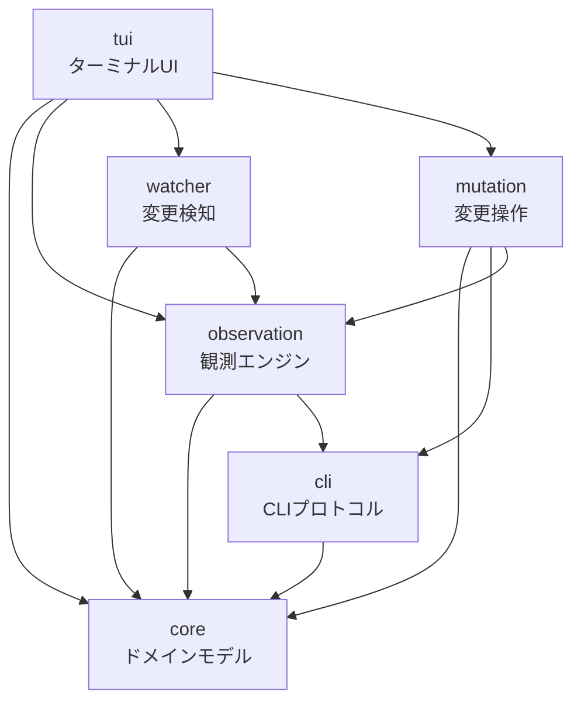

# Vijutsu Surv IR 設計サマリー

> spec_vijutsu_v02.md の要件を spec-surv-ir-v1.1.md のフォーマットで設計に落とした結果

---

## ファイル構成

```
surv.toml                          # プロジェクトマニフェスト
design/
  core/domain.toml                 # コアドメインモデル（21 schema）
  cli/protocol.toml                # CLI実行・parseプロトコル（7 schema, 9 func, 1 mod）
  observation/engine.toml          # 観測エンジン（6 schema, 7 func, 2 mod）
  watcher/watchers.toml            # 変更検知（4 schema, 5 func, 3 mod）
  tui/interface.toml               # ターミナルUI（13 schema, 6 func, 3 mod）
  mutation/operations.toml         # 変更操作（8 schema, 8 func, 3 mod）
```

---

## パッケージ依存グラフ



---

## 要件仕様 → 設計のマッピング

| 仕様セクション | 設計ファイル | 主要な型 |
|---|---|---|
| §7 ドメインモデル | [domain.toml](file:///Users/masatakashioji/prog/vijutsu/design/core/domain.toml) | `RepositoryObservation`, `ChangeNode`, `OperationNode`, `OperationDelta` |
| §6 CLI protocol | [protocol.toml](file:///Users/masatakashioji/prog/vijutsu/design/cli/protocol.toml) | `CommandEnvelope`, `ChangeRecord`, `OperationRecord`, `ParseResult` |
| §8 OperationDelta計算 | [engine.toml](file:///Users/masatakashioji/prog/vijutsu/design/observation/engine.toml) | `computeOperationDelta`, `HeadValidation`, `DeltaComparisonView` |
| §3.5 選択状態復元 | [engine.toml](file:///Users/masatakashioji/prog/vijutsu/design/observation/engine.toml) | `SelectionState`, `resolveOperationSelection`, `resolveChangeSelection` |
| §9 Operation head / 並行変更 | [watchers.toml](file:///Users/masatakashioji/prog/vijutsu/design/watcher/watchers.toml) | `WatchEvent`, `MultipleHeadsView`, `watchOperationHeads` |
| §10 複数operation head | [watchers.toml](file:///Users/masatakashioji/prog/vijutsu/design/watcher/watchers.toml) | `detectMultipleHeads`, `MultipleHeadsView` |
| §11 Working copy / 鮮度 | [engine.toml](file:///Users/masatakashioji/prog/vijutsu/design/observation/engine.toml) | `checkFreshness`, `ObservationFreshness` |
| §12 画面要件 | [interface.toml](file:///Users/masatakashioji/prog/vijutsu/design/tui/interface.toml) | `Layout`, `OperationPane`, `ChangePane`, `DiffPane`, `PreviewPanel` |
| §13 操作別要件 | [operations.toml](file:///Users/masatakashioji/prog/vijutsu/design/mutation/operations.toml) | `UndoPreview`, `RestorePreview`, `RevertPreview`, `AbandonPreview` |
| §14 Capability検出 | [domain.toml](file:///Users/masatakashioji/prog/vijutsu/design/core/domain.toml) + [protocol.toml](file:///Users/masatakashioji/prog/vijutsu/design/cli/protocol.toml) | `JjCapabilities`, `detectAllCapabilities`, `probeCapability` |
| §15 キー操作 | [interface.toml](file:///Users/masatakashioji/prog/vijutsu/design/tui/interface.toml) | `KeyAction`, `handleKeyInput` |
| §3.4 二階プレビュー | [interface.toml](file:///Users/masatakashioji/prog/vijutsu/design/tui/interface.toml) | `PreviewPanel`（6次元効果表示） |

---

## 設計上のポイント

### 1. CLI隔離の徹底（§6 → `cli/protocol.toml`）

`CommandEnvelope` がすべての jj 呼び出しを包む。`JJ_CONFIG=""` + `--color=never` + `--no-pager` + `--quiet` + 明示的 `--at-op` で設定汚染を遮断。revset 入力は subprocess 引数として直接渡し、shell を介さない。

### 2. TOCTOU安全な観測（§9.4 → `observation/engine.toml`）

`acquireObservation` が H1→graph取得→H2 の手順で head 集合の一致を検証。不一致時は stale 判定 + 上限付きリトライ。`ObservationToken` が全ペインの整合性を保証。

### 3. 暗黙統合の排除（§10 → `watcher/watchers.toml`）

`detectMultipleHeads` は各 head を個別表示し、ユーザー選択を待つ。Inspect の副作用として統合を行わない。`HeadIntegrationPreview` は明示的 Mutate 操作として分離。

### 4. 二階プレビューの6次元表示（§3.4 → `tui/interface.toml`）

`PreviewPanel` は mutation 実行前に必ず6つの効果軸を提示:
- Change graph / Operation graph / Working copy / Bookmarks / Remote tracking / Recoverability

### 5. 能力ベースの縮退（§14 → `core/domain.toml` + `cli/protocol.toml`）

`JjCapabilities` の各フラグは実際のコマンド成功で判定（バージョン番号推定ではない）。`previewRedo` は capability false なら無効化 + op restore を代替案内。
